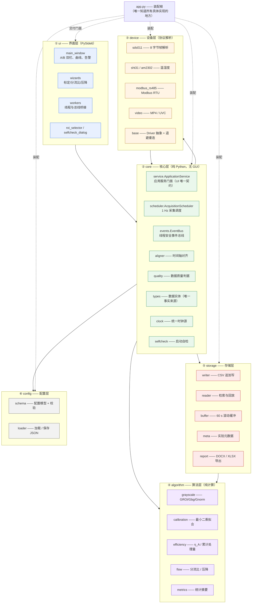
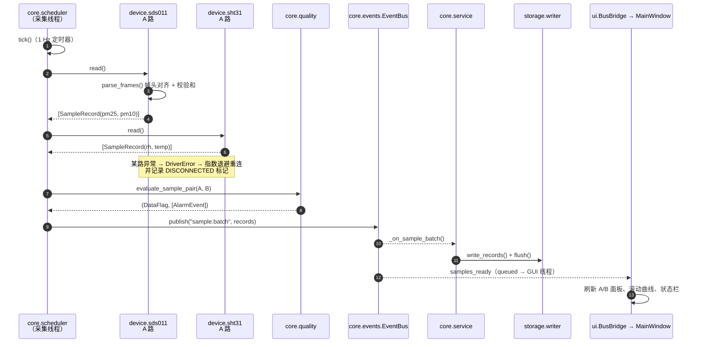
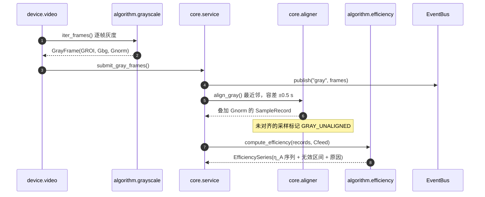
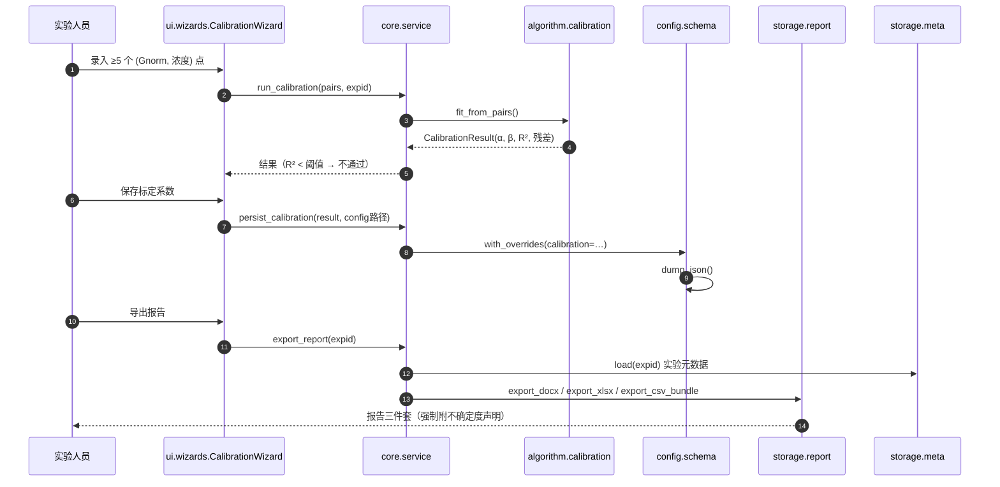
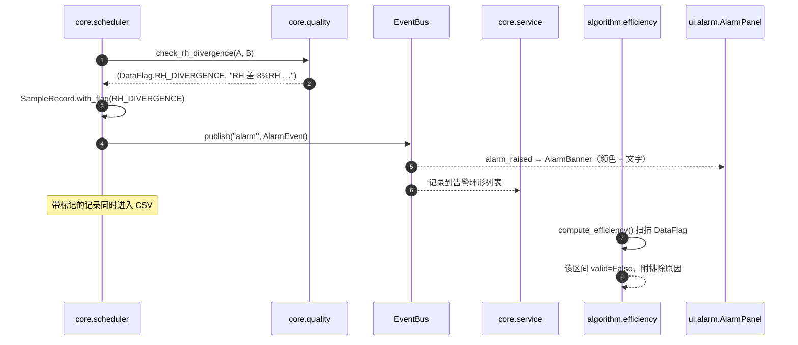
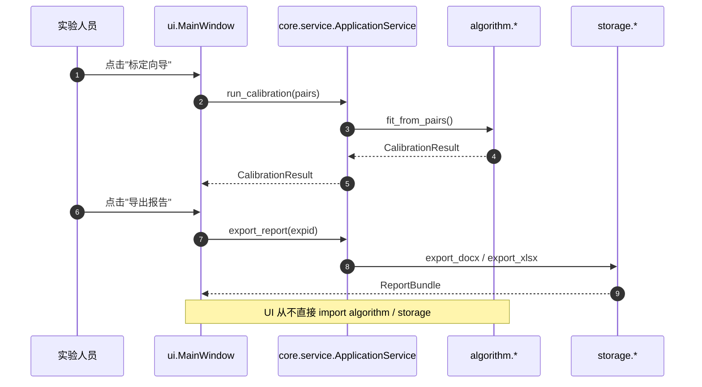
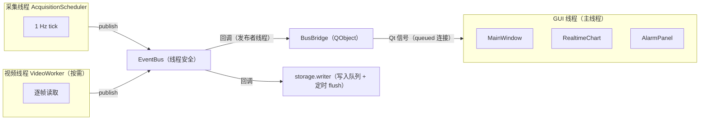

# 软件架构与模块间相互作用

> 对应《数据采集与计算校准系统 软件需求说明书（SRS）》V3.2-SRS-001
> 文档定位：本文档说明**软件基本框架**（分层与模块职责）以及**各模块间的相互作用**
> （依赖方向、数据流、控制流、线程模型、接口契约）。

---

## 1. 总体框架

### 1.1 分层架构

系统按 SRS NFR-7「模块化分层（设备 / 核心 / 算法 / 存储 / 界面 / 配置）」组织，
共 6 层 + 1 个装配根。



### 1.2 依赖方向规则（硬约束）

| 规则 | 说明 |
| --- | --- |
| **单向向下** | `ui → core → device / algorithm / storage / config`，禁止反向 import |
| **UI 不碰内核实现** | `ui` 只 import `core.service`（应用服务门面）与 `core.types`（数据实体） |
| **core 不碰 GUI** | `core` 全层不得 import `PySide6`（NFR-3 可移植性、NFR-7 分层） |
| **algorithm 是纯叶子** | 只依赖 `numpy` + `core.types`，不读设备、不写文件 |
| **config 是独立叶子** | 只依赖标准库，任何层都可安全读取 |
| **core 不依赖 storage** | 存储通过事件总线订阅接入，装配在 `app.py` 完成 |
| **无循环依赖** | `daccs.core.__init__` 采用惰性导入（PEP 562），打断 `core ⇄ device` 的包级环 |

违反规则的可通过静态检查发现：

```bash
# UI 层之外不得出现 GUI 框架
grep -rn "PySide6" daccs --include=*.py | grep -v "^daccs/ui/"
# algorithm 层不得依赖其他内部层
grep -rn "^from \.\." daccs/algorithm --include=*.py | grep -v "core.types"
```

---

## 2. 模块职责与对外接口

### 2.1 职责一览

| 层 | 模块 | 职责 | 对应需求 |
| --- | --- | --- | --- |
| device | `base` | `Driver` 抽象、`ReconnectPolicy`（指数退避，≤5 s）、`SerialTransport` 协议 | FR-1.4、NFR-2 |
| device | `sds011` | 8 字节帧解析、校验失败丢弃并计数、驱动封装 | FR-1.1~1.4、§6.1 |
| device | `sht31` | SHT31 I2C 0x44/0x45、AM2302 单总线解析 | FR-2.1、§6.2 |
| device | `modbus_rs485` | Modbus RTU 0x03/0x04、CRC16、量程换算 | FR-3.1、§6.3 |
| device | `video` | MP4 / UVC 取帧、转灰度、时间戳打点 | FR-4.1、§5.3 |
| device | `serial_port` / `i2c` | 可选依赖隔离（pyserial / smbus2） | NFR-3、§8.3 |
| core | `types` | 数据实体：`SampleRecord`、`GrayFrame`、`CalibrationResult`、`EfficiencyResult`、`ExperimentMeta`、`DataFlag` | §5.1 |
| core | `clock` | 唯一时间来源（全系统只有这里取墙钟） | §2.4-2、§5.3 |
| core | `events` | 线程安全事件总线（模块解耦装置） | NFR-2、NFR-7 |
| core | `scheduler` | 1 Hz 调度、驱动读取、异常隔离与重连、跨支路判据 | FR-1、FR-2、§2.4-1 |
| core | `aligner` | 灰度—采样最近邻对齐，容差 ±0.5 s | §5.3 |
| core | `quality` | 互差 / RH 差 / GROI 溢出 / 亮度 / 分流比判据 | §7.4、FR-2.2、FR-6.2 |
| core | `service` | **应用服务门面**：UI 的唯一 API 入口 | NFR-7 |
| core | `selfcheck` | 启动自检：串口枚举、握手、视频源、配置合法性 | FR-10.2 |
| algorithm | `grayscale` | GROI / Gbg / Gnorm、暗电流基线、gt、灰卡校正 | FR-4.2~4.5、§7.1 |
| algorithm | `calibration` | 最小二乘 `C = α·Gnorm + β`，输出 α/β/R²/残差 | FR-7.1、FR-7.2、§7.3 |
| algorithm | `efficiency` | `η_A = 1 − CA,out / Cfeed`、累计处理量、无效区间标记 | FR-8.1~8.3、§7.2 |
| algorithm | `flow` | 分流比 uA/uB（≤1.05）、压降 Δplung（0.5 Pa） | FR-3.3、FR-7.3、FR-7.4 |
| algorithm | `metrics` | 统计摘要（均值/中位数/标准差/极值） | FR-5.3 |
| storage | `writer` | CSV **只追加**、UTF-8 BOM、缓冲落盘 | FR-5.1、§6.4、NFR-6 |
| storage | `reader` | 按实验编号检索与回放、统计摘要 | FR-5.3 |
| storage | `buffer` | 60 s 滚动环形缓冲（界面曲线数据源） | FR-6.3 |
| storage | `meta` | 实验元数据（编号/日期/发烟源/针阀/灯条/操作者） | FR-5.2 |
| storage | `report` | DOCX + XLSX + CSV 三件套导出 | FR-9.1、FR-9.2 |
| ui | `main_window` | A/B 双栏、工具栏、状态栏 | FR-6.1 |
| ui | `realtime_chart` | 60 s 滚动曲线 | FR-6.3 |
| ui | `alarm` | 告警条（颜色 + 文字双提示） | FR-6.2、NFR-4 |
| ui | `wizards` | 标定 / 分流比 / 压降三个向导 | FR-7.1~7.4 |
| ui | `roi_selector` | ROI 框选 | FR-4.1 |
| ui | `selfcheck_dialog` | 自检报告展示 | FR-10.2 |
| ui | `workers` | 采集/视频线程 + 事件总线 → Qt 信号桥接 | NFR-1、NFR-2 |
| config | `schema` | 配置模型 + 校验（`validate`） | FR-10.1、FR-10.2 |
| config | `loader` | 查找/加载/保存 JSON | FR-10.1 |
| — | `app.py` | **装配根**：按配置构建对象图 | — |

### 2.2 依赖矩阵

行 = 导入方，列 = 被导入方；✅ 表示允许，❌ 表示禁止。

| 导入方 ↓ / 被导入 → | ui | core | device | algorithm | storage | config |
| --- | :---: | :---: | :---: | :---: | :---: | :---: |
| **ui** | — | ✅ 仅 `service` / `types` | ❌ | ❌ | ❌ | ✅ |
| **core** | ❌ | — | ✅ | ✅ | ❌（经总线间接） | ✅ |
| **device** | ❌ | ✅ 仅 `types` / `clock` | — | ❌ | ❌ | ❌ |
| **algorithm** | ❌ | ✅ 仅 `types` | ❌ | — | ❌ | ❌ |
| **storage** | ❌ | ✅ 仅 `types` | ❌ | ✅ | — | ❌ |
| **config** | ❌ | ❌ | ❌ | ❌ | ❌ | — |

要点：

- **device → core 只有两个入口**（`types` 的实体、`clock` 的时间），保证设备层是"哑"的；
- **core ⇄ storage 完全通过事件总线**：`core` 不 import `storage`，由 `app.py` 把
  `storage.writer` 订阅到 `sample.batch` 话题上；
- **storage → algorithm** 只有一处（`report` 需要统计摘要、`reader` 需要指标计算），
  且方向向下不构成环。

---

## 3. 关键交互流程

### 3.1 流程 A：一个采集周期的完整链路



### 3.2 流程 B：视频灰度 → 时间轴对齐 → η_A



### 3.3 流程 C：标定向导 → 拟合 → 归档 → 报告



### 3.4 流程 D：告警触发与数据标记



### 3.5 流程 E：界面层如何"不碰"内核实现



---

## 4. 线程模型



规则：

1. **只有 GUI 线程可以改控件**。工作线程到 GUI 的数据一律经 Qt 信号（queued 连接自动切线程）；
2. **事件总线回调在发布者线程同步执行**，因此订阅者不得做耗时操作：
   - `storage.writer` 只把行塞进队列，flush 由定时器或显式调用触发；
   - `ui` 的订阅者只做 `emit`，不碰控件；
3. **采集线程不因界面卡顿而阻塞**：界面刷新在 GUI 线程，与采集完全隔离；
4. **崩溃恢复**：原始数据只追加，重启后可从 `data/raw/<expid>/samples.csv` 续写（NFR-2）。

---

## 5. 数据流与时间轴

### 5.1 时间戳与对齐

- 采样通道：1 Hz，毫秒时间戳（SRS §2.4 约束 1、§5.3）；
- 灰度：按视频帧率打时间戳；
- 对齐：最近邻，容差 **±0.5 s**；超出容差 → 标记 `GRAY_UNALIGNED`，
  该条采样不参与 η_A 计算（FR-8.3）。

### 5.2 数据实体与落盘字段

`samplerecord`（FR-5.1）→ CSV 列：

| 时间戳 | 通道 | PM2.5 | PM10 | RH | T | Gnorm | 标记位 | 风速 | 压降 |
| --- | --- | --- | --- | --- | --- | --- | --- | --- | --- |
| `2026-11-27 10:00:00.000` | A | 12.345 | 18.900 | 55.1 | 25.0 | 342.1 | RH_DIVERGENCE | 0.4321 | 0.2100 |

- 文件：UTF-8 **带 BOM**，Excel 双击可开（§6.4）；
- 追加式：只 `a` 模式打开，永不覆盖（§2.4 约束 3、NFR-5）；
- 缺测写空串，**不写 0**，避免把"缺测"算成"浓度为零"。

### 5.3 标记位语义

| 标记 | 触发条件 | 后果 |
| --- | --- | --- |
| `RH_DIVERGENCE` | RH 差 > 5%RH | 该时段 η_A 排除（FR-2.2） |
| `SENSOR_DIVERGENCE` | 两路 PM2.5 互差 > 10% | 标记不可用（FR-6.2） |
| `GROI_OVERFLOW` | GROI ≥ 255 | 提示降亮度（FR-6.2） |
| `INSUFFICIENT_BRIGHTNESS` | GROI/Gbg < 12 | 提示亮度不足（FR-6.2） |
| `SPLIT_RATIO_EXCEEDED` | uA/uB > 1.05 | 提示 B 侧重配平（§7.4） |
| `DISCONNECTED` | 断线/重连期间 | 数据不参与计算（FR-1.4） |
| `GRAY_UNALIGNED` | 灰度未能在 ±0.5 s 对齐 | 不参与计算（§5.3） |
| `EFFICIENCY_EXCLUDED` | 被效率计算排除 | 报告中说明原因（FR-8.3） |
| `MANUAL_REVIEW` | 人工标记 | 待复核 |

---

## 6. 接口契约（跨模块调用点）

跨层调用的全部"公开面"，新增实现只需满足这些签名：

### 6.1 设备层 → 核心层

```python
class Driver(ABC):
    name: str
    def open(self) -> None: ...
    def read(self) -> list[SampleRecord]: ...
    def close(self) -> None: ...
    def reconnect(self, reason: str = "") -> ReconnectEvent | None: ...
```

### 6.2 核心层 → 算法层（纯函数）

```python
fit_from_pairs(pairs, threshold=0.95, source_expid="", created_at=0.0) -> CalibrationResult
extract_frame_grayness(frame, roi, baseline, ts, frame_index, gcard_value=None) -> GrayFrame
compute_efficiency(samples, cfeed, channel=Channel.A, rh_divergence=None) -> EfficiencySeries
compute_split_ratio(velocities_a, velocities_b, threshold=1.05) -> SplitRatioResult
evaluate_plunge_dp(dp_pa, threshold=0.5) -> PlungeDpResult
```

### 6.3 核心层 → 存储层

```python
CsvAppendWriter.write_record(record) / write_records(records) / flush(force=False) / close()
HistoryReader.query(expid, channel=None, start_ts=None, end_ts=None) -> SampleQuery
ExperimentStore.save(meta) / load(expid) / list_experiments()
export_docx(path, meta, samples, calibration, efficiency, uncertainty_note) -> Path
export_xlsx(path, meta, samples, calibration, efficiency, uncertainty_note) -> Path
export_csv_bundle(out_dir, samples, gray_rows, expid) -> list[Path]
```

### 6.4 界面层 → 核心层（`ApplicationService` 公开 API）

| 方法 | 用途 | 需求 |
| --- | --- | --- |
| `start()` / `stop()` | 启停采集 | FR-6 |
| `snapshot()` | A/B 实时快照 + RH 差 + η_A 预估值 | FR-6.1 |
| `recent(channel, window_s)` | 60 s 滚动曲线数据 | FR-6.3 |
| `alarms(limit)` | 告警列表 | FR-6.2 |
| `submit_gray_frames(frames)` | 提交灰度帧 | FR-4.4 |
| `align_gray(tolerance_ms)` | 灰度—采样对齐 | §5.3 |
| `extract_gray_from_video(...)` | 视频逐帧提取 | FR-4.1~4.3 |
| `run_calibration(pairs, expid)` | 标定拟合 | FR-7.1 |
| `persist_calibration(result, path)` | 标定系数回写配置 | FR-10.1 |
| `compute_efficiency(samples, cfeed)` | η_A 计算 | FR-8.1 |
| `compute_split_ratio(va, vb)` | 分流比 | FR-3.3 |
| `evaluate_plunge_dp(dp)` | 压降判据 | FR-7.4 |
| `list_experiments()` / `query_history(expid)` / `replay_summary(expid)` | 历史检索与回放 | FR-5.3 |
| `save_experiment_meta(meta)` | 实验元数据 | FR-5.2 |
| `export_report(expid, out_dir, cfeed)` | 报告三件套 | FR-9 |
| `self_check()` | 启动自检 | FR-10.2 |
| `status()` | 运行状态 | FR-10.2 |

---

## 7. 关键设计决策与理由

| # | 决策 | 理由 |
| --- | --- | --- |
| D1 | **事件总线作为唯一解耦装置**，模块之间不直接互相调用 | 界面崩溃不影响采集；存储层可整体替换；单元测试可只订阅某几个话题 |
| D2 | **UI 只依赖 `ApplicationService` 门面** | 界面框架可替换；内核可被脚本/自动化复用；依赖单向无环 |
| D3 | **核心层不含 PySide6** | NFR-3 可移植性（图形差异隔离）；核心可在无 GUI 环境跑测试 |
| D4 | **协议解析拆成纯函数 + 薄 I/O 包装** | NFR-7 要求单测覆盖解析；无硬件也能验证帧解析 |
| D5 | **`core` 不依赖 `storage`，存储经总线订阅接入** | 避免 core 变成大杂烩；写入策略（CSV/SQLite）可替换 |
| D6 | **数据实体集中在 `core.types`，全系统单一事实来源** | 界面、算法、存储共用同一组 dataclass，避免字段漂移 |
| D7 | **缺测用 `None` 而非 0** | 0 会被算进均值/拟合，得到错误结论 |
| D8 | **`DataFlag` 位掩码只追加不清除** | FR-8.3 要求不达标区间能"排除并说明"，标记必须可追溯 |
| D9 | **Gbg 计算时扣除 ROI 自身** | ROI 在 2 倍外扩框中恒占 25% 面积，计入则 95 百分位必然落在 ROI 上，Gnorm 恒为 100 而失去归一化意义 |
| D10 | **`daccs.core.__init__` 惰性导入** | `core.service → core.scheduler → device.base → core.clock` 会形成包级循环依赖，惰性导入在不牺牲使用体验的前提下打断该环 |
| D11 | **拟合用 `numpy.linalg.lstsq` 而非 `scipy`** | 一元最小二乘 numpy 足够，减少打包体积与版本兼容风险（SRS 附录 1） |
| D12 | **测试用标准库 `unittest`** | 无需额外依赖即可在目标机与 CI 上运行；pytest 亦可直接收集 |
| D13 | **报告必须携带不确定度声明，缺失即报错** | SRS §2.4 约束 5：不得以软件计算结果冒充标准方法结论 |

---

## 8. 扩展点

| 需求 | 扩展方式 | 需改动的文件 |
| --- | --- | --- |
| 新增传感器协议 | 实现 `Driver` 子类 + 纯解析函数，在 `build_drivers` 注册 | `device/<new>.py`、`app.py` |
| 换用 SQLite 存储 | 实现同 `writer`/`reader` 签名的类，在 `app.py` 替换装配 | `storage/<new>.py`、`app.py` |
| 换 GUI 框架 | 重写 `ui/`（保持 `ApplicationService` 调用不变） | `ui/*` |
| 新增计算指标 | 在 `algorithm/` 加纯函数，经 `service` 暴露给 UI | `algorithm/<new>.py`、`core/service.py` |
| 新增配置项 | 在 `config/schema.py` 加字段 + `default.json` 同步 | `config/schema.py`、`config/default.json` |
| 新增告警判据 | 在 `core/quality.py` 加检查函数，由 `scheduler.apply_quality` 调用 | `core/quality.py`、`core/scheduler.py` |

---

## 9. 目录结构（源码）

```
daccs/
├── app.py                  # 装配根
├── __main__.py             # python -m daccs 入口
├── logging_setup.py
├── core/                   # ② 核心层
│   ├── types.py  clock.py  events.py
│   ├── aligner.py  quality.py  scheduler.py
│   ├── selfcheck.py  service.py
├── device/                 # ③ 设备层
│   ├── base.py  sds011.py  sht31.py
│   ├── modbus_rs485.py  video.py
│   ├── serial_port.py  i2c.py
├── algorithm/              # ④ 算法层
│   ├── grayscale.py  calibration.py
│   ├── efficiency.py  flow.py  metrics.py
├── storage/                # ⑤ 存储层
│   ├── writer.py  reader.py  buffer.py
│   ├── meta.py  report.py
├── ui/                     # ① 界面层
│   ├── main_window.py  realtime_chart.py  alarm.py
│   ├── wizards.py  roi_selector.py
│   ├── selfcheck_dialog.py  workers.py  theme.py
└── config/                 # ⑥ 配置层
    ├── schema.py  loader.py  default.json
```

运行时目录（安装后，SRS §9.2）：

```
数据采集与计算校准系统/
├── app.exe
├── config/default.json
├── drivers/CH341SER.EXE
├── data/raw/<expid>/{samples.csv, meta.json}
├── data/report/{<expid>_report.docx, <expid>_report.xlsx}
├── logs/daccs.log
└── README.pdf
```
